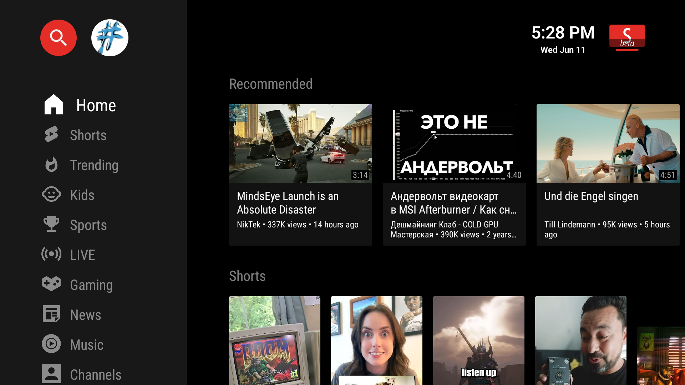
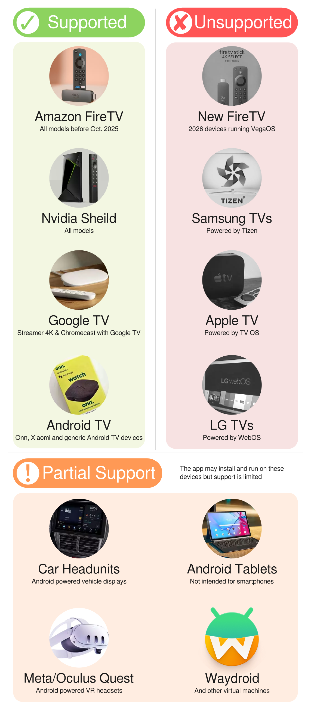
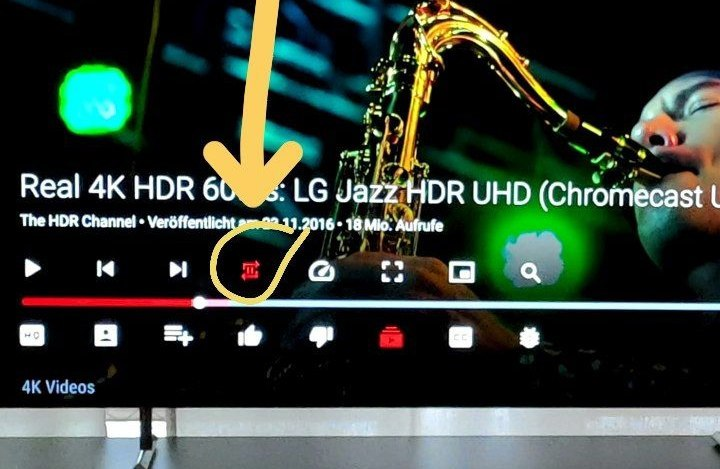

# YouTubePro

> **О проекте:** это форк **[SmartTube](https://github.com/yuliskov/smarttube)** — оригинального приложения от **yuliskov**. Все заслуги за оригинальное приложение SmartTube принадлежат его автору. Этот форк продолжает разработку под новым названием **YouTubePro** и распространяется под той же лицензией MIT (см. [LICENSE](LICENSE)).

---

[](https://f-droid.org/packages/app.smarttube.fdroid/)
[](https://github.com/yuliskov/SmartTube/releases)

# Важное объявление о приложении

Моя среда разработки была заражена неизвестным вредоносным ПО, из-за чего некоторые сборки могли быть затронуты. Обнаружив проблему, я обезопасил всё с помощью полной очистки диска, восстановил чистое окружение, и теперь все сборки проверяются через VirusTotal. Версия для F-Droid также будет проверена перед выпуском.

Публичные ключи могли быть скомпрометированы, поэтому я сообщаю об этой проблеме. Новую версию и новый публичный ключ можно скачать ниже, там же приведены инструкции по восстановлению резервных копий.

Дополнительных действий не требуется, поскольку приложение использует **одноразовые коды подключения**. У таких кодов очень ограниченные права (например, они не могут изменить ваш пароль). Тем не менее, при желании вы можете отозвать доступ для полного спокойствия.

# Как отозвать доступ:

1. Откройте [myaccount.google.com/security](https://myaccount.google.com/security)
2. Найдите раздел **«Подключения к сторонним приложениям и сервисам»** (Your connections to third-party apps & services)
3. Нажмите **«Посмотреть все подключения»** и найдите **YouTube TV** или **Google Диск**
4. Выберите приложение → **«Удалить доступ»**

Пожалуйста, держите встроенные функции безопасности включёнными, чтобы оставаться защищёнными.

# YouTubePro



YouTubePro — бесплатный медиаплеер с открытым исходным кодом для Android TV и TV-приставок. Он позволяет просматривать и воспроизводить контент из различных публичных источников в интерфейсе, оптимизированном для телевидения.

### ✅ Возможности
- Чистый интерфейс
- Интеграция SponsorBlock
- Регулируемая скорость воспроизведения
- Поддержка разрешения 8K
- Воспроизведение с частотой 60 fps
- Поддержка HDR
- Просмотр чата трансляций
- Настраиваемые кнопки
- Не требует сервисов Google
- Дружное международное сообщество

### ❌ Ограничения
- Не поддерживается на смартфонах и планшетах
- Функциональность комментариев нестабильна
- Голосовой поиск и трансляция (cast) могут уступать официальным приложениям — зависит от устройства

Попробуйте!

**Есть вопросы?** Сначала воспользуйтесь поиском (Ctrl+F или ⌘F) по этому ридми!

[**Установка**](#установка) | [**Сайт**](https://smarttubeapp.github.io) | [**Участники**](#участники) | [**Пожертвования**](#пожертвования) | [**FAQ**](#faq) | [Поддержка / чат](#поддержка) | [Сборка](#сборка) | [Перевести приложение](https://jtbrinkmann.de/tools/android-strings.xml-translator.html) | [Список изменений](https://t.me/s/SmartTubeNewsEN) | [Ответственность](#ответственность)


## Поддержка устройств
> [!IMPORTANT]  
> Начиная с октября 2025 года новые устройства Amazon FireTV больше не работают на базе Android. YouTubePro **не будет** совместим с Fire Stick 4k Select и более новыми устройствами, которые работают под управлением собственной ОС Amazon — VegaOS.


* **Поддерживаются:** все Android TV и TV-приставки (включая все FireTV, выпущенные до октября 2025, NVIDIA Shield и Chromecast с Google TV), даже старые — с Android 4.3 (Kitkat).
* **Не поддерживаются:** смартфоны и не-Android платформы: Samsung Tizen, LG webOS, Apple TV и т.д.

## Установка

> [видео установки](images/new/zPV0imF.mp4) (примечание: ссылка для скачивания изменилась на `kutt.to/stn_beta` или `kutt.to/stn_stable`)

**Не** скачивайте YouTubePro из **магазинов приложений**, с APK-сайтов или блогов; там файлы загружены посторонними людьми и могут содержать вредоносное ПО или рекламу. YouTubePro официально не публикуется ни в одном магазине приложений.

Есть **бета-релиз** (рекомендуется) и **стабильный релиз**. Бета быстрее стабильной версии получает новые функции и исправления.

Установить приложение можно любым из следующих способов:

- (**Проще всего**) Установите на Android TV [Downloader by AFTVnews](https://www.aftvnews.com/downloader/), откройте его и введите `kutt.to/stn_beta` или `kutt.to/stn_stable`, затем прочитайте, поймите и подтвердите предупреждения безопасности. (<small>Также можно ввести [**79015**](https://aftv.news/79015) (для беты) или [**28544**](https://aftv.news/28544) (для стабильной версии), но это требует дополнительного шага — установки браузерного дополнения AFTVnews Downloader, если оно ещё не установлено.</small>)
- Установите на Android TV приложение для передачи файлов, скачайте APK на телефоне или компьютере и передайте его на телевизор (например, [_Send Files to TV_](https://sendfilestotv.app/) из Google Play Store / Amazon AppStore)
- Скачайте APK на USB-накопитель, вставьте его в телевизор и откройте через файловый менеджер из Google Play Store / Amazon AppStore (например, [_FX File Explorer_](https://play.google.com/store/apps/details?id=nextapp.fx) или [_X-plore_](https://play.google.com/store/apps/details?id=com.lonelycatgames.Xplore)). Предустановленный файловый менеджер Android не подходит! Не используйте захламлённый рекламой _FileCommander_.
- Если вы опытный пользователь, можно установить приложение через ADB. [руководство](https://fossbytes.com/side-load-apps-android-tv/#h-how-to-sideload-apps-on-your-android-tv-using-adb) | [альтернативное руководство](https://www.aftvnews.com/sideload/)

**Устранение неполадок:** смотрите примечания к конкретным устройствам ниже. Если установка не удалась, либо **закончилось место на диске**, либо APK-файл скачался некорректно; освободите место и попробуйте скачать снова. Если приложение установилось, но падает при запуске — убедитесь, что оно установлено во внутреннюю память, а не на SD-карту / внешнее хранилище.

**В приложении есть встроенный механизм обновления** со списком изменений. Все релизы и **changelog** также доступны в [Telegram-канале @SmartTubeNewsEN](https://t.me/s/SmartTubeNewsEN) (читается без аккаунта) или на [GitHub](https://github.com/yuliskov/SmartTube/releases/).

> последняя [**бета-версия**](https://github.com/yuliskov/SmartTube/releases/download/latest/smarttube_beta.apk)
>
> последняя [стабильная версия](https://github.com/yuliskov/SmartTube/releases/download/latest/smarttube_stable.apk)


### Установка (Chromecast с Google TV)

На **Chromecast с Google TV** установка приложений по умолчанию заблокирована, поэтому нужен дополнительный шаг:

> **4.1. Включите параметры разработчика**
>
> На Chromecast откройте боковое меню и перейдите в _Настройки > Система > Об устройстве_. Прокрутите вниз до раздела _Сборка Android TV OS_ и нажимайте на него многократно. Появится уведомление о том, что вы в нескольких шагах от того, чтобы стать разработчиком. Продолжайте нажимать, пока не активируется.
>
>
> **4.2. Включите настройку «неизвестные источники»**
>
> Вернитесь на главную страницу _Настроек_ и выберите _Приложения > Безопасность и ограничения > Неизвестные источники_. Включите переключатель для [_Downloader by AFTVnews_ или] того файлового менеджера, который вы решили использовать [...].
>
> [[источник и иллюстрированное руководство](https://www.androidpolice.com/2021/02/07/how-to-sideload-any-apk-on-the-chromecast-with-android-tv/#install-the-apk)]

После этого следуйте [общему руководству по установке](#установка) выше.


### Установка (устройства Xiaomi с китайской прошивкой)

**Китайская прошивка** Xiaomi может блокировать установку **бета-версии**. Международная прошивка не затронута. Решения:
1. Используйте **стабильную версию** YouTubePro (**рекомендуется**)
2. Используйте международную прошивку для вашего устройства
3. (если устройство 2020 года или старше) Можно выполнить сброс к заводским настройкам и установить YouTubePro beta до установки любых системных обновлений. После этого систему можно спокойно обновлять — YouTubePro должен продолжить работать.


### Обновление

В приложении есть встроенный механизм обновления. Процедуру установки нужно пройти **только один раз**. Через несколько секунд после запуска YouTubePro уведомит о наличии обновления и покажет список изменений. Автоматическую проверку обновлений можно отключить или обновить вручную в настройках в разделе «о программе».

Если установка не удалась, либо **закончилось место на диске**, либо обновление скачалось некорректно; освободите место и попробуйте обновиться снова (_Настройки > О программе > Проверить обновления_).


## Совместимость

YouTubePro требует Android 4.3 или выше. Он не работает на не-Android устройствах (включая телевизоры LG или Samsung). На неподдерживаемых телевизорах можно использовать TV-стик или TV-приставку. Хотя приложение технически запускается на смартфонах и планшетах, оно не оптимизировано под них и официальной поддержки не имеет!

Приложение успешно проверено на телевизорах, приставках и стиках на базе Android, включая:

- Android TV и Google TV (например, Philips, Sony)
- Chromecast с Google TV и телевизоры с _Chromecast built-in_
- Amazon FireTV stick (все поколения)
- NVIDIA Shield
- Приставки на Android (множество дешёвых китайских no-name коробок)
- Xiaomi Mi Box


## Возможности

### Интерфейс

YouTubePro делает упор на чистый интерфейс без отвлекающих элементов для просмотра медиаконтента. Приложение не содержит рекламных элементов интерфейса и сосредоточено на воспроизведении и навигации.


### SponsorBlock

YouTubePro включает необязательную интеграцию SponsorBlock. Со [сайта SponsorBlock](https://sponsor.ajay.app/):

> SponsorBlock — это браузерное расширение с открытым исходным кодом и открытый API на основе краудсорсинга для **пропуска рекламных вставок** в видео YouTube. [...] расширение автоматически пропускает **известные ему** рекламные сегменты с использованием системы запросов, сохраняющих приватность. Оно также поддерживает пропуск **других категорий**, таких как вступления, концовки и напоминания подписаться [а также немузыкальные фрагменты в музыкальных видео].

Категории для пропуска можно выбрать в настройках. В отличие от браузерного дополнения, в YouTubePro нельзя отправлять новые сегменты (телевизоры и пульты — не лучшие устройства для таких точных операций). Учтите, что SponsorBlock — бесплатный добровольный проект, основанный на данных от пользователей, поэтому не ждите от него стопроцентной работы. Иногда сегменты ещё не добавлены в базу, иногда серверы SponsorBlock недоступны или перегружены.


### Трансляция (Cast)

Чтобы транслировать видео с телефона (или другого устройства), нужно привязать это устройство к телевизору. В отличие от оригинального приложения YouTube, YouTubePro не появляется автоматически, когда вы в одной Wi-Fi сети. Как связать смартфон и телевизор:

1. откройте YouTubePro и перейдите в настройки
2. откройте «Пульт ДУ» (второй пункт)
3. откройте приложение YouTube на телефоне, перейдите в настройки > Общие > смотреть на телевизоре
4. нажмите _подключить по ТВ-коду_ и введите код с экрана телевизора

[**Руководство со скриншотами**](https://t.me/SmartTubeEN/8514)

Из-за технических ограничений перед трансляцией нужно открыть приложение на телевизоре; YouTubePro не может автоматически разбудить телевизор.

Если вы хотите, чтобы отправка с телефона также будила телевизор и запускала YouTubePro, можно воспользоваться сторонним приложением [TubeBeam](https://github.com/jagjordi/tubebeam). Оно добавляет пункт _Отправить на ТВ_ в системное меню «Поделиться» и отправляет ссылку на телевизор через ADB вместо трансляции (требуется включить _Отладка по USB_ / _Отладка по сети_ в параметрах разработчика телевизора).


### Картинка в картинке (PiP)

YouTubePro поддерживает воспроизведение видео в режиме «картинка в картинке». Его нужно включить в _Настройки > Общие > Фоновое воспроизведение > Картинка в картинке_. Видео перейдёт в режим PiP при нажатии кнопки «домой» во время просмотра, а также при нажатии _назад_, если это включено в _Настройки > Общие > Фоновое воспроизведение (активация)_.


### Регулировка скорости

Скорость воспроизведения можно изменить, нажав на значок индикатора скорости (спидометр) в верхнем ряду плеера. Выбор запоминается для всех видео. Некоторые скорости могут приводить к пропускам кадров — это известная проблема.


### Голосовой поиск

Для включения глобального голосового поиска рядом с YouTubePro нужно установить дополнительное приложение. Это _приложение-мост_ позволяет системному голосовому поиску открывать YouTubePro вместо стандартного приложения YouTube. Для этого нужно удалить оригинальное приложение YouTube. Мы знаем, что это неудобно, но при желании вы всегда сможете установить его обратно. _Приложение-мост_ не отображается в списке приложений и не запускается напрямую; оно используется только системным голосовым поиском. На некоторых устройствах при поиске нужно явно произносить «Youtube» (например, «youtube милые котики» вместо просто «милые котики»).

**На Amazon Fire TV**: 

1. Удалите оригинальное приложение YouTube (root не требуется)
2. Скачайте и установите приложение Amazon Bridge для YouTubePro: https://kutt.to/stn_bridge_amazon (например, через _Downloader by AFTVnews_)


**На Google Chromecast с Google TV**: 

1. Удалите оригинальное приложение YouTube (root не требуется)
2. Скачайте и установите приложение ATV Bridge для YouTubePro: https://kutt.to/stn_bridge_atv (например, через _Downloader by AFTVnews_)


**На всех остальных Android-устройствах**, к сожалению, требуется root:

1. Получите root-доступ (найдите руководство для вашего устройства)
2. Удалите официальное приложение YouTube с помощью root (`adb shell pm uninstall com.google.android.youtube.tv`)
3. Скачайте и установите приложение ATV Bridge для YouTubePro: https://kutt.to/stn_bridge_atv (например, через _Downloader by AFTVnews_)

## Участники

Основные участники проекта:

- [@pixkk](https://github.com/pixkk): стриминг SABR, генерация TV PoToken/Challenge 
- [@Jupiops](https://github.com/Jupiops): поддержка SABR CDN

## Пожертвования

Если вы хотите поддержать разработку — с радостью примите чашечку кофе :)

- **PayPal (основной)**: firsth<!-- abc@def -->ash@gmai<!-- @abc.com -->l.com  
- [**Patreon (альтернатива, бесплатно)**](https://www.patreon.com/smarttube)
- **BTC**: 1JAT5VVWarVBkpVbNDn8UA8HXNdrukuBSx  
- **LTC**: ltc1qgc24eq9jl9cq78qnd5jpqhemkajg9vudwyd8pw  
- **ETH**: 0xe455E21a085ae195a097cd4F456051A9916A5064  
- **ETC**: 0x209eCd33Fa61fA92167595eB3Aea92EE1905c815  
- **TRX**: TJNPY794aSGZf3WGHTna2VCWm2G5Yua7E8  
- **USDT (TRC20)**: TJNPY794aSGZf3WGHTna2VCWm2G5Yua7E8  
- **USDT (BEP20)**: 0x64B28da787BE6ac5889D276A5638d4f077840eC5  
- **USDT (ERC20)**: 0xe455e21a085ae195a097cd4f456051a9916a5064   
- **TON**: UQAc9zgnnzwS8yb5wxAu5CB0RddmjPBjWI-n46oQ7XfCQrgI  
- **XMR**: 48QsMjqfkeW54vkgKyRnjodtYxdmLk6HXfTWPSZoaFPEDpoHDwFUciGCe1QC9VAeGrgGw4PKNAksX9RW7myFqYJQDN5cHGT    


## Поддержка

**Сначала, пожалуйста, загляните в [FAQ](#faq)!** Также хотя бы коротко просмотрите недавнюю историю чата.

Сообщить о проблеме можно в нашей Telegram-группе или через [issue-трекер на GitHub](https://github.com/yuliskov/SmartTube/issues) (нужен аккаунт).

- **Telegram-группа (международная)**: [@SmartTubeEN](http://t.me/SmartTubeEN)  
- **Discord-группа (международная)**: [SmartTube Official](https://discord.gg/Wt8HDDej5z)  
- **Telegram-группа (RU/UA)**: [@SmartTubeUA](http://t.me/SmartTubeUA)

Международная группа общается **только на английском**. Но не переживайте, если ваш английский не идеален, — у нас дружное международное сообщество.


## Команда

YouTubePro разрабатывается одним человеком; за проектом не стоит большая команда или компания. Это открытый любительский проект. Несколько человек помогали с переводами — часть из них видна на [GitHub](https://github.com/yuliskov/SmartTube/graphs/contributors), часть присылала переводы напрямую Юрию. В чате поддержки тоже есть отзывчивые люди.


## Сборка
    
**ПРИМЕЧАНИЕ: CI-сборка использует OpenJDK 17 (см. `.github/workflows/CI.yml`). Прежнее требование OpenJDK 14 или старше больше не действует.**  
Для сборки и установки отладочной версии выполните следующие команды:

```
git clone https://github.com/endlessbum/youtubepro.git
cd youtubepro
git submodule update --init
adb connect <ip_адрес_устройства>
gradlew clean installStstableDebug
```


## Видеокодеки

Видеокодеки — это алгоритмы, используемые для сжатия видео.


### Какой кодек выбрать / обзор

|          | рекомендация                                 | аппаратная поддержка        | сжатие, битрейт\*                    | качество |
|:--------:|:---------------------------------------------|:---------------------------- |:----------------------:|:-------:|
| **AV01** aka. AV1 | лучший выбор, **если устройство поддерживает** | первые устройства появились в **2020**   | **лучший** <small>(напр. 1.6 Мбит/с)</small>   | то же   |
| **VP9**  | **лучший выбор на большинстве устройств**    | большинство устройств **с 2015** | **лучше** <small>(напр. 2.1 Мбит/с)</small> | то же   |
| AVC  | только для старого или медленного железа | **все** устройства          | хорошо <small>(напр. 2.7 Мбит/с)</small>   | то же   |


<small>\* Примеры взяты из видеодорожки (только видео) в 1080p @ 25fps для этого видео: [Dua Lipa - New Rules (Official Music Video)](https://youtube.com/watch?v=k2qgadSvNyU)</small>

При одинаковом разрешении **чем ниже битрейт, тем лучше!** YouTube целенаправленно обеспечивает **одинаковое качество** независимо от кодека. Старые кодеки имеют более высокий битрейт только потому, что они менее эффективны. На YouTube **нельзя** получить лучшее качество, просто выбрав более высокий битрейт. Новые кодеки лучше сжимают = ниже битрейт = меньше трафика = экономия ресурсов. Это возможность, а не баг. Используйте самый новый кодек, который плавно работает на вашем устройстве, а не самый неэффективный. У AVC обычно самый высокий битрейт. Это плохо, а не хорошо.


### Какое качество выбрать?

Сейчас нет автоматического режима на основе вашей пропускной способности. Но вы можете сами настроить видео-профиль по умолчанию в настройках \> видеоплеер \> видео-профили. Первый вариант («нет») запоминает ваш последний выбор внутри плеера. Любой другой профиль используется изначально для каждого видео; если выбранный профиль недоступен, берётся следующий лучший доступный вариант. В плеере вы по-прежнему можете переопределить профиль для каждого видео отдельно.

Чтобы выбрать оптимальное разрешение / качество видео, учтите несколько ограничивающих факторов:
- Ваша пропускная способность (выбирайте только до того битрейта, который выдерживает ваш канал; скорость можно проверить через [fast.com](https://fast.com) от Netflix)
- Разрешение экрана телевизора (качество **может немного** улучшиться при выборе следующего, более высокого разрешения, например 1080p на экране 720p; но не ждите большой разницы)
- Возможности телевизора (например, HDR, 60fps)

В целом 60fps — это улучшение, но если вы лично не замечаете разницы (или она вам не важна), можно сэкономить трафик, не выбирая 60fps.


### HDR

HDR работает только **если ваше железо его поддерживает**. Это запутанная история:
- Телевизор должен поддерживать HDR
- Если вы используете приставку, то и приставка, **и** кабель телевизора, **и** сам телевизор должны поддерживать HDR
- Да, реально существуют разные версии HDMI-кабелей с разной поддержкой HDR, всё непросто
- некоторые устройства (например, **NVIDIA Shield**) в целом поддерживают HDR, но **не** конкретный формат HDR, используемый на YouTube :cry:
 
Если HDR-видео выглядит тусклым или выцветшим, прочитайте [эту статью](https://www.wired.com/story/hdr-too-dark-how-to-fix-it/). **Если HDR не работает**, скорее всего, виновато не приложение. Возможно, стоит поискать в интернете «HDR» вместе с названием вашего устройства.

## Ответственность

Мы не несём ответственности за использование нашего инструмента или внешних
экземпляров, предоставленных третьими сторонами. Мы настоятельно рекомендуем
соблюдать действующие официальные правила вашей страны. Кроме того, мы снимаем
с себя ответственность за любое ненадлежащее использование сторонних сервисов.
Этот инструмент предоставляется вам в духе свободного открытого ПО.

Лицензию, на условиях которой предоставляется это ПО, можно посмотреть [здесь](./LICENSE).

>   16. Ограничение ответственности.
>
> IN NO EVENT UNLESS REQUIRED BY APPLICABLE LAW OR AGREED TO IN WRITING
WILL ANY COPYRIGHT HOLDER, OR ANY OTHER PARTY WHO MODIFIES AND/OR CONVEYS
THE PROGRAM AS PERMITTED ABOVE, BE LIABLE TO YOU FOR DAMAGES, INCLUDING ANY
GENERAL, SPECIAL, INCIDENTAL OR CONSEQUENTIAL DAMAGES ARISING OUT OF THE
USE OR INABILITY TO USE THE PROGRAM (INCLUDING BUT NOT LIMITED TO LOSS OF
DATA OR DATA BEING RENDERED INACCURATE OR LOSSES SUSTAINED BY YOU OR THIRD
PARTIES OR A FAILURE OF THE PROGRAM TO OPERATE WITH ANY OTHER PROGRAMS),
EVEN IF SUCH HOLDER OR OTHER PARTY HAS BEEN ADVISED OF THE POSSIBILITY OF
SUCH DAMAGES.

## FAQ

### В: Видео очень сильно буферизуются

О: Попробуйте перейти на зашифрованный DNS, например NextDNS. Такой DNS можно настроить автоматически или вручную. Для автоматической настройки можно использовать [Intra с F-Droid](https://f-droid.org/en/packages/app.intra/) и apk [«AutoStart - No root»](https://play.google.com/store/apps/details?id=com.autostart), чтобы он запускался после каждой перезагрузки TV. Для ручной настройки [используйте это руководство](https://www.reddit.com/r/MiBox/s/7esEVGtAAa).

### В: Поиск не выдаёт результатов по моему запросу (Android 11)

О: Есть сообщения, что последнее обновление «Google app for Android TV» может вызывать этот баг. Удаление обновления должно помочь.


### В: AV01 не воспроизводится / Почему VP9 медленный на моём устройстве?

О: Поскольку AV01 очень новый, **большинство** телевизоров и приставок **не имеют** аппаратной поддержки и **вообще не могут** воспроизводить AV01.

Если у устройства есть аппаратная поддержка кодека, видео с этим кодеком должны идти плавно. Высокие разрешения также могут тормозить в VP9 на дешёвых приставках, официально не поддерживающих 4k. Скорее всего, ваше устройство способно воспроизводить VP9 даже без аппаратной поддержки, но для плавности нужен мощный процессор. Исправить AV01 без аппаратной поддержки технически возможно, но пока не планируется и, вероятно, недостаточно эффективно.


### В: Можете сделать YouTubePro похожим на оригинальное приложение?

О: По сравнению с интерфейсом YouTubePro, обычный YouTube и YT Kids сильно впереди. Однако нужен человек, обладающий навыками и готовый вложить достаточно времени и сил в создание такого интерфейса. И в его долгосрочную поддержку (включая новые функции и исправления багов). И всё это бесплатно. Если у вас есть или появился такой человек — помогите, пожалуйста.
К слову, YouTubePro следует официальному шаблону и рекомендациям Google для приложений Android TV. Это вина Google, что шаблон отчасти некрасивый. 😂


### В: Можно ли улучшить страницу поиска?

О: Можно, но нужно, чтобы кто-то это сделал — аналогично предыдущему пункту FAQ. YouTubePro следует официально рекомендованному Google дизайну/шаблону для TV-приложений и использует официальную предустановленную клавиатуру Android TV. К сожалению, Google сделал страницу поиска и клавиатуру очень плохо. Возможно, будущее обновление YouTubePro добавит встроенную клавиатуру, как в оригинальном YouTube или других крупных приложениях Android TV. Возможно, удастся сделать внешний вид таким же хорошим или лучше, чем в официальном приложении YouTube. Но пока всё так, как есть: не хватает времени, а официальные рекомендации Google плохи.


### В: Можно ли установить это на Samsung Tizen TV / LG webOS TV / Roku / iOS / тостер?

О: Нет, это работает только на **Android**-устройствах. На странице продукта любого Android TV обычно прямо указано, что он работает на Android. Приложение **нельзя** просто портировать на другие платформы, и мы даже не собираемся пытаться. **Пожалуйста, не спрашивайте**. Вместо этого подключите к телевизору отдельный TV-стик или TV-приставку.


### В: Можно ли установить это на смартфон? / Добавите портретный режим? / Не работает прокрутка.

О: **Твёрдое нет**. Это приложение **не для смартфонов**, мы обеспечиваем **нулевую поддержку** таких сценариев.

Но вы **можете транслировать** видео **с** смартфона на телевизор / приставку с YouTubePro. Просто используйте официальное приложение YouTube, [Morphe](https://github.com/MorpheApp) или [ReVanced](https://github.com/ReVanced), подробнее в [разделе о трансляции](#трансляция-cast).

**Версии для телефонов не будет.** Вместо этого можно использовать [Morphe](https://github.com/MorpheApp), [ReVanced](https://github.com/ReVanced), [Pure Tuber](https://play.google.com/store/apps/details?id=free.tube.premium.advanced.tuber), [LibreTube](https://github.com/libre-tube/LibreTube), [NewTube](https://github.com/aleixrodriala/newtube), [NewPipe](https://newpipe.schabi.org) или [NewPipe x SponsorBlock](https://github.com/polymorphicshade/NewPipe#newpipe-x-sponsorblock). За помощью обращайтесь в их чаты поддержки.


### В: Можно ли установить это на планшет / экран в автомобиле / смартфон с док-станцией?

Да... возможно.. Требования:

- Это Android-устройство
- У него большой экран
- Есть ТВ-пульт, геймпад или клавиатура
  **Сенсорный ввод не поддерживается.** Прокрутка мышью/тачпадом тоже. Полноценно использовать YouTubePro только с сенсорным вводом или мышью нельзя.

Некоторые пользователи сообщали об успехе (в том числе на [мультимедиа-системе автомобиля](https://t.me/SmartTubeEN/6060)). **Делитесь своими историями успеха с нами.**


### В: Ошибки «неизвестный кодек» / «не удаётся скачать видео»

О: подождите 5 секунд, пока видео начнёт играть. Если не помогло — нажмите кнопку воспроизведения. Некоторые пользователи сообщали, что проблема возникает только при подключённом USB-аудио устройстве или при заполненном диске.


### В: Ошибка «профиль видео не поддерживается»

О: Нажмите кнопку «HQ» слева внизу, выберите _форматы видео_ и выберите что угодно, кроме AV01. AV01 **не поддерживается** на большинстве устройств (видимо, включая ваше), поэтому выберите VP9. Подробнее в [разделе о видеокодеках](#видеокодеки).


### В: Ошибка «видео недоступно» при просмотре скрытых видео / моих собственных видео

О: Да, это текущий баг.


### В: Приложение не появляется в списке устройств для трансляции

О: Прочитайте раздел [Трансляция (Cast)](#трансляция-cast).

### В: Ошибка «Войдите, чтобы подтвердить, что вы не робот»

О: Диапазон вашего IP-адреса может быть временно или навсегда заблокирован YouTube для просмотра видео, если вы не вошли в свой аккаунт.

### В: Видео постоянно буферизуется

О: Проблема может быть не специфична для YouTubePro — её же отмечают другие неофициальные приложения YouTube. Сейчас это редкость, но во 2-м квартале 2021 года было очень распространено. У некоторых пользователей или устройств проблема проявляется сильнее. Официальное приложение и сайт YouTube, судя по всему, затронуты редко. Корневая причина пока неясна, похоже, это серверная особенность YouTube. Возможно, YouTube дискриминирует сторонние приложения.

Пока попробуйте проверить, помогает ли:
- Снизить разрешение (или вернуть обратно)
- Сменить формат видео на AVC
- Увеличить буфер в настройках
- Нажать «назад» и запустить видео снова


### В: Отладочная информация говорит, что мой экран 1080p, но у меня 4k/UHD!

О: Не волнуйтесь, **отладочная информация неверна.** YouTubePro отлично работает и выше 1080p — вы сами это увидите при воспроизведении видео в 4k или UHD.
Также не волнуйтесь, если указано «720p», а у вас экран 1080p.


### В: Почему не выбирается автоматически максимальное качество?

О: **Выбирается** (по умолчанию). Если вы задали _видео-профиль_ в настройках, он выступает потолком для автоматического выбора. Проверьте, не настроен ли у вас видео-профиль; снять его можно, выбрав «нет».

**Не путайте качество с битрейтом.** Подробнее в [разделе о видеокодеках](#видеокодеки).


### В: Можно ли задать (максимальное) разрешение по умолчанию?

О: YouTubePro автоматически выбирает максимальное доступное качество для видео, вплоть до максимального разрешения, которое можно задать в настройках в разделе «видео-профиль». Если доступно, будет выбран заданный видео-профиль, иначе — следующий лучший доступный. В любом случае профиль можно изменить прямо во время просмотра.


### В: Может ли разрешение быть «авто», в зависимости от моей пропускной способности?

О: Это запланировано, но пока недоступно (извините 🙇‍♀️). Впрочем, можно задать максимальное разрешение, подходящее вашему каналу. Подробнее выше.


### В: Почему приложение пропускает фрагменты видео?

О: В YouTubePro есть функция **SponsorBlock**. Можно выбрать, какие категории пропускать, если вообще нужно. Подробнее в [разделе SponsorBlock](#sponsorblock).


### В: Как включить автоплей следующего видео / остановку после каждого видео?

О: Переключайтесь между режимами автовоспроизведения кнопкой «повтор» 🔁

[](https://t.me/SmartTubeEN/24953)


### В: Как убрать нерелевантные мне рекомендованные видео (например, новости)?

О: Рекомендации определяются YouTube, а не приложением — мы не можем изменить алгоритм. Они основаны на вашей стране, которую можно сменить в настройках. Если вы вошли в аккаунт, они основаны на истории просмотра, данных профиля и прочем, что Google использует. Если вы не вошли — вы как в «режиме инкогнито», и история просмотра не влияет на рекомендации. Возможно, будущая версия добавит опциональное профилирование без входа в аккаунт.


### В: Работает ли HDR?

О: Да, HDR работает, **если ваше железо** его поддерживает. **NVIDIA Shield** — нет. Подробнее в [разделе о HDR](#hdr).


### В: Почему в changelog некоторых обновлений написано «не обновляйтесь, если вас всё устраивает»?

О: Такие обновления сильно меняют код в попытке исправить баги, затрагивающие лишь некоторых пользователей/устройства. Обновляться должны только затронутые пользователи. Остальным обновление не даёт ничего, кроме шанса получить новые баги. Не переживайте, если всё же обновились.


### В: При воспроизведении на других скоростях пропускаются кадры!

О: Сейчас мы не можем это исправить, извините.


### В: Что такое AFR?

О: «Auto Frame Rate» (автоматическая частота кадров). Функция подстраивает частоту обновления телевизора под просматриваемый контент. Она может немного улучшить плавность, но разница очень мала; большинство людей её едва замечает. Не на каждом железе работает хорошо. Если вы не знаете, что она делает, и не хотите проверять — спокойно держите её выключенной.

**Рекомендация:** включите, чтобы проверить, работает ли она на вашем устройстве; если вызывает проблемы (или не хотите тестировать) — выключите.


### В: Какой буфер выбрать — большой или маленький?

О: Чем больше буфер, тем больше видео будет предзагружено впереди текущей позиции. Маленький буфер может немного снизить расход трафика, если вы часто закрываете видео до конца. Большой буфер сглаживает сетевые проблемы и не даёт видео останавливаться для подгрузки. Больший буфер увеличивает потребление памяти, но это не должно быть проблемой.

**Рекомендация: большой**.


### В: Сохраняется ли буфер при перемотке назад?

О: Нет: когда вы перематываете назад (например, на 5 секунд), YouTubePro придётся заново буферизовать. Это может быть улучшено в будущих обновлениях.


### В: Устройство зависает при просмотре YouTube

О: Это проблема прошивки или Android. Если у вас кастомная прошивка, возможно, в ней баг. Отладить такое разработчику практически невозможно, поэтому мы не сможем помочь, извините. Можно попробовать стандартные меры: перезагрузка, очистка кэша, переустановка приложения или сброс устройства к заводским настройкам.


### В: Можно ли скачивать видео?

О: Нет, в YouTubePro такой функции нет.


### В: Могут ли обновления устанавливаться автоматически?

О: Нет, технически это невозможно. Нужное разрешение есть только у предустановленного менеджера приложений (обычно Google Play Store, Amazon AppStore и т.п.). Все остальные приложения, включая YouTubePro, могут лишь показать окно установки. Обход через root возможен, но пока не реализован.


### В: Можно ли отключить блокировку рекламы на некоторых каналах?

О: Нет, это невозможно. В YouTubePro вообще нет кода для показа рекламы. Добавление такой функциональности заняло бы время и силы, которые вместо этого тратятся на полезные функции и исправление багов.
